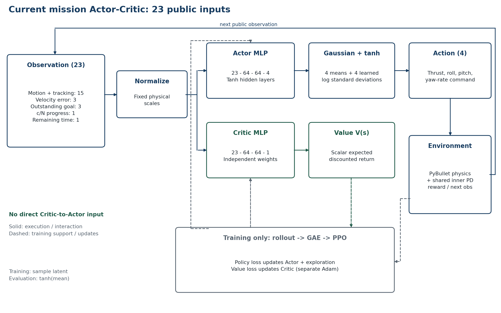

# ME5418 Group 39 - Final team handoff

Release: **19 November 2026**. This is the reproducible source/model/documentation
handoff for the group, not an individual final report. Read
[START_HERE_组员必读.md](START_HERE_组员必读.md) for the Chinese handoff.

## What changed in this release?

The TA asked for a visible Actor-Critic data path and clearer reuse of the
earlier Conda environment. This release adds a diagram, shared technical note,
old-to-new dependency table, corrected update commands and consistent inventory.

**All 45 Python files, both models, the main training JSON and both environment
specifications are byte-identical to the latest source archive supplied by the
group on 19 November.** No refactoring, formatting or extra Python module was
introduced here. The per-file hashes in `verification/code_preservation.json`
prove preservation, not authorship or an originality score.

- [Architecture PNG](docs/actor_critic_architecture.png) / [vector SVG](docs/actor_critic_architecture.svg)
- [Shared technical handoff PDF](docs/ME5418_Group39_Technical_Handoff.pdf) / [editable text](docs/TECHNICAL_HANDOFF.md)
- [Complete environment migration](docs/ENVIRONMENT_MIGRATION.md)
- [Response to the TA](docs/TA_FEEDBACK_RESPONSE.md)
- [Recorded results and limits](results/RESULTS_SUMMARY.md)
- [Code provenance and disclosures](CODE_PROVENANCE.md)



The shared technical note is **not a substitute for any member's required
individual final report**. `report/` preserves the November 6 two-page Learning
Agent report as clearly labelled history. Check final course upload rules
separately. The supplied video is in `media/`.

## 1. Install, or reuse the previous environment

Run commands from this directory. The verification target is Linux x86-64 CPU,
Python 3.11.5 and PyTorch 2.2.2+cpu, with in-process PyBullet DIRECT simulation.
No GPU, separate simulator, dataset or external pretrained policy is required.
Installation needs internet. Darwin/Windows recreation is not newly verified.

### A. Create the current environment (isolated option)

```bash
conda env create --file environment.yml
conda activate me5418-learning-agent
python verify_setup.py --strict-versions
python -m pip check
python -m pytest -q
python -m tools.verify_submission
```

### B. Update the earlier Neural Network environment, keeping its name

The earlier environment was **me5418-aerial-spraying**. It is not the current
YAML's default name. Target it explicitly, then activate that same old name:

```bash
conda env update --name me5418-aerial-spraying --file environment.yml --prune
conda activate me5418-aerial-spraying
python verify_setup.py --strict-versions
python -m pip check
python -m pytest -q
python -m tools.verify_submission
```

Close running training processes first. Save an export outside this release
directory if the old environment is shared with other work. No environment is
renamed above. Pruning can remove Conda-managed extras; pip extras may remain.
Prefer A when isolation matters.

### C. Refresh an already-existing current-named environment

```bash
conda env update --name me5418-learning-agent --file environment.yml --prune
conda activate me5418-learning-agent
python verify_setup.py --strict-versions
python -m pip check
```

### Dependency changes since the Neural Network assignment

| Dependency | Previous submission | Current pin / purpose |
|---|---|---|
| Environment name | me5418-aerial-spraying | me5418-learning-agent; explicit update target needed |
| Python | 3.11.6 | 3.11.5; CPU interpreter pin |
| PyTorch | 2.2.2 | 2.2.2+cpu on Linux; same base framework version |
| NumPy | 1.24.3 | 1.26.4; numerical calculations |
| Matplotlib | 3.7.2 | 3.9.4; plots |
| Pillow | 13.0.0 | 12.3.0; images/GIFs, a repin not an upgrade |
| pytest | 7.4.0 | 8.3.5; tests |
| PyYAML | Not explicitly declared | 6.0.3; environment verification |
| ReportLab | Not explicitly declared | 4.4.4; PDF generation, not policy learning |
| charset-normalizer | Not explicitly declared | 3.5.2; ReportLab dependency |
| setuptools | Not explicitly pinned | 65.5.0; packaging toolchain |
| Gymnasium / PyBullet | 1.2.1 / 3.2.7 | Unchanged API / simulator |

[ENVIRONMENT_MIGRATION.md](docs/ENVIRONMENT_MIGRATION.md) lists all other repins.
The unchanged YAML and requirements file remain authoritative. No SB3,
imitation-learning library or different simulator was introduced. Actual
release checks, including resource limitations, are in `verification/`.

## 2. First run: CPU network demo and saved-policy check

```bash
python -m demo.demo_network --steps 128 --updates 1 --output outputs/my_network_demo.json
python -m pure_rl.evaluate --checkpoint models/mission_ppo.pt --episodes 3 --seed-start 92000 --output evaluations/my_check
```

The group-supplied demo exercises the **23-input mission network**: observation,
Gaussian mean/std, bounded action, Critic value, gradient norms, optimizer
steps and changed parameters in both branches. One update is a mechanism check,
not convergence. Reusing the demo output path overwrites its JSON/PT; choose
a different path to retain an old run. Evaluation/training directories must be
new. Three episodes are a regression check, not a general success-rate claim.

## 3. Training commands

Short random-initialized training-path check:

```bash
python run_learning_agent.py --total-timesteps 4096 --eval-every 1 --eval-episodes 1 --output runs/my_smoke
```

Full configured training from random weights:

```bash
python run_learning_agent.py --output runs/my_random_training
```

PPO-only continuation with the supplied group-trained foundation:

```bash
python run_learning_agent.py --warm-start-pure models/foundation_ppo.pt --output runs/my_continuation
```

The successful supplied model used **two PPO stages**, not expert labels,
behavior cloning or imitation weights. The 15-input foundation learned coarse
tracking. The continuation widens inputs to 23, copies/rescales the first 15
weight columns, initially zeros the added columns and restarts Adam. It learns
the new task features from interaction reward. See `models/README.md`.

To reproduce the procedure without supplied weights:

```bash
python train.py --total-timesteps 300000 --n-steps 2048 --seed 7 --eval-every 20 --eval-episodes 3 --output runs/my_foundation_300k
python train.py --resume runs/my_foundation_300k/final.pt --total-timesteps 1000000 --output runs/my_foundation_1m
python run_learning_agent.py --warm-start-pure runs/my_foundation_1m/best.pt --output runs/my_mission
```

Convergence is not guaranteed. The original 15-input and current 23-input
checkpoint formats/evaluators are not interchangeable. Main settings are in
`configs/mission_ppo.json`. The current budget counts decisions across eight
clients. Action repeat 2 gives roughly 10 Hz outer control and 20 Hz physics/
inner control; separately logged physical steps handle early terminations.

The older trainer's resume starts a fresh episode. The new vectorized trainer
does not expose exact mid-run resume or restore eight live simulator states.
Saved weights and Adam states are not a full live-physics snapshot.

## 4. Evaluation, results and replay

```bash
python -m pure_rl.evaluate --checkpoint models/mission_ppo.pt --episodes 50 --seed-start 70000 --output evaluations/published_reproduction
python -m pure_rl.evaluate --checkpoint models/mission_ppo.pt --episodes 1 --seed-start 90000 --animation --output evaluations/my_replay
python -m tools.summarize_results
```

The 50-seed command reproduces **published seeds**, not a new independent test.
Evaluation retains the original rest start, full wind, 2 m/s timed reference,
ten ordered 3-D arrivals within 0.5 m and a 45 s deadline. No curriculum resets,
early-miss cutoff or shaped evaluation reward is used. The plot command rebuilds
derived files from stored data; it does not train and can overwrite plots.
Regenerate the manifest only after intentional edits, not to hide corruption.

| Historical comparison | Full-task success | Timed 3-D RMSE |
|---|---:|---:|
| Selected PPO continuation 7 | 50/50 | 0.829 m |
| Continuation 8, same foundation | 36/50 | 0.936 m |
| Direct random-start variant | 0/50 | 2.633 m |
| Tuned traditional PD/PID | 50/50 | 0.639 m |

The additional seeds 91000-91009 scored **9/10**, with seed 91009 timing out at
7/10 points; see `verification/quality_review/fresh_10_episodes.csv`.
Stronger base wind (4.5 m/s): PPO 17/20, tuned classical 20/20. Finite 50/50 is
not universal 100% success. Budgets/rates differ and continuations share one
foundation. There is **no demonstrated superiority over tuned PID**, isolated
observation ablation, real-flight evidence or spray-deposition assessment.

## 5. Architecture and task advance

MLPs suit the compact numerical state/task vector; no image input requires a
CNN. Two 64-unit Tanh layers are a modest inherited CPU baseline, **not proven
optimal**.

- Original 15 motion/tracking features + reference-velocity error (3) + next
  outstanding-goal error (3) + completed fraction (1) + remaining time (1) = 23.
- Actor: 23-64-64-4 plus four learned state-independent log standard deviations.
  Training samples a Gaussian latent then applies tanh; evaluation uses tanh(mean).
- Critic: 23-64-64-1, separate parameters, predicts V(s). Its output is **not an
  Actor input**; it supports training-time GAE/value regression.
- The outer action commands thrust deviation, roll, pitch and yaw rate. Shared
  inherited inner PD applies torques, without providing expert labels.

Stage 2 already counted physical ordered arrivals. The advance is **exposing
completed history and the next outstanding goal**, not adding waypoints or
relaxing success. A missed goal stays visible after the timed reference moves
on; the reference/return-to-goal conflict is not completely removed.

## 6. Organization and integrity

`environment/`: unchanged simulator; `rl/`: foundation network/workflow;
`pure_rl/`: current task/collection/PPO/evaluation; `configs/`: main settings;
`models/`: PPO weights; `evidence/`: original measurements; `results/`: derived
presentations; `docs/`: current handoff; `report/`: historical milestone report;
`media/`: supplied video; `verification/`: scoped check records.
[CODE_GUIDE.md](CODE_GUIDE.md) maps inputs and source locations.
[CODE_PROVENANCE.md](CODE_PROVENANCE.md) retains method/library/AI disclosures.

Seven byte-identical historical evidence aliases are stored once; the mapping
is in `evidence/trial_history/README.md`. No nested source ZIP, cache, local
environment or transient training directory is included. The manifest describes
the actual handoff and the group's unchanged checker validates its hashes.
Release smoke checks are not new policy selection or long training.
