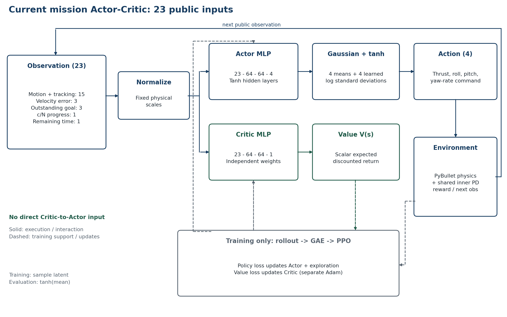

# ME5418 Group 39
## Aerial spraying: final technical handoff

Shared reference for group members | 19 November 2026

### 1. Purpose and release boundary

The project studies trajectory tracking by a simulated spraying quadrotor under
wind and decreasing liquid payload. The learning objective is to complete the
ordered route while controlling tracking error and avoiding crashes/boundary
violations. Waypoint completion is not a measurement of spray deposition or
real flight safety.

The Environment milestone supplied the simulator; the Neural Network milestone
supplied an actor-critic and one PPO update. The Learning Agent work added
sustained sampling, optimization, checkpoints, validation, reward logs and
independent full-mission evaluation. Its main task-information advance is to
show the policy the actual completed-waypoint fraction and the next outstanding
goal. The previous environment already counted those arrivals internally.

This release addresses the TA's presentation and reproducibility feedback. It
adds the explicit Actor-Critic diagram, an old-to-new dependency comparison,
unambiguous Conda update targets and an accurate package inventory. The latest
group-supplied CPU demo already exercises the current 23-input network.

**Code protection.** All 45 Python files, both supplied PPO checkpoints, the
main training JSON and both dependency specifications are byte-identical to
the latest incoming group source. No new Python helper, reformatting, network
change or retraining is introduced. Per-file SHA-256 values are recorded in
verification/code_preservation.json. Identity demonstrates preservation of that
source, not an independently established originality percentage or authorship.

### Why an MLP, and why 64-64?

The observations are a compact vector of numerical motion and task quantities,
not images. A fully connected MLP can combine these variables without a CNN's
spatial assumptions. Two Tanh hidden layers of 64 units are the inherited,
modest CPU baseline: more expressive than a linear mapping, but small enough
for repeated on-policy simulation. This is a reasonable starting choice, not
evidence that 64-64 is optimal. No width/depth comparison was conducted here.

The current actor-critic has 11,721 trainable parameters. The historical
15-input model had 10,697. The added parameters widen the first layers of both
branches; the hidden/output design is retained. More information does not by
itself guarantee easier optimization or reliable convergence.

### How to use this note

Start with README and the Chinese START_HERE handoff. Read the architecture on
the next page, then the training/evaluation boundary, environment migration and
measured results. This is a shared technical reference, **not an individual
final report** or confirmation of the final course upload rules. The old
two-page Learning Agent report is preserved separately as dated history.

<!-- PAGE -->

## 2. Observation, Actor and Critic



Figure 1. Current 23-input architecture. Solid arrows show observations/actions
and interaction; dashed arrows are training-only. V(s) does not enter Actor
input. The four learned log standard deviations are state-independent.

| Input slice (zero-based) | Meaning |
|---|---|
| 0:15 | Inherited position, velocity, Euler angles, angular rates and reference-position error |
| 15:18 | Reference velocity minus vehicle velocity in the submitted goal preset |
| 18:21 | Next outstanding waypoint[c] minus current vehicle position |
| 21 | c/N: actual ordered-arrival fraction |
| 22 | Remaining time divided by the 45 s horizon |

Fixed physical scales normalize the inputs; they are not fitted on held-out
tests. The Actor maps 23-64-64-4 to four latent Gaussian means. Four separate
learned log standard deviations determine exploration. Training samples a
latent and applies tanh; deterministic evaluation uses tanh(mean). The Critic
maps 23-64-64-1 to a scalar discounted-return estimate with independent weights.

The same observation reaches both branches. Critic values help form GAE during
learning, rather than choosing actions directly. The output commands thrust
deviation, roll, pitch and yaw rate; the inherited inner PD attitude stabilizer
turns commands into torques. No expert action labels are supplied.

True wind and remaining liquid mass are hidden. Public task history helps but
does not turn the entire physical problem into a fully observed state. A missed
goal remains visible when the timed reference moves on; their competing
objectives are not completely reconciled by adding inputs.

<!-- PAGE -->

## 3. Learning workflow and evaluation boundary

Eight independent PyBullet clients produce on-policy transitions. The collector
preserves unfinished episodes across rollout boundaries, computes per-client
GAE and then batches samples. The Actor uses the clipped PPO policy objective;
the Critic fits interaction-derived return targets. Value regression is normal
actor-critic RL, not supervised imitation of correct actions.

| Main configured setting | Value / interpretation |
|---|---|
| Collection | 8 clients x 256 decisions per rollout |
| Actor / value learning rate | 3e-4 / 1e-3, with learning-rate decay |
| PPO epochs / minibatch | 8 / 256 |
| Discount / GAE lambda | 0.9975 / 0.97 per decision |
| Clip range / target KL | 0.2 / 0.02 |
| Gradient norm limit | 0.5 |
| Action hold / physics dt | Up to 2 physical steps / 0.05 s |
| Main continuation budget | 400,000 decisions across clients |

Source of truth: configs/mission_ppo.json. The policy runs at about 10 Hz;
physics and the shared inner control run at 20 Hz. Early termination can shorten
an action hold. Decisions, physical steps and wall-clock duration are different
quantities and are logged separately.

### Training-only assistance

The wrapper combines 0.1 times raw reward with goal progress, actual-arrival
events, task outcomes and small goal/yaw penalties. Main event terms include
+10 per newly earned arrival, +30 success and -30 timeout. Partial-route starts,
weaker wind and early missed-goal cutoffs ease early exploration and disappear
by the final quarter. Declared skipped prefixes receive no reset reward and
are logged separately from newly earned arrivals. Shaping is heuristic, not
proven policy-invariant.

### Unchanged full-task assessment

Evaluation uses the original start at rest, full randomized wind/payload,
2 m/s timed reference, 45 s horizon and all ten ordered 3-D arrivals within
0.5 m. Completion also retains reference/end-position requirements. No partial
resets, early-miss cutoff or shaped evaluation return is used. Success count,
ordered points, tracking RMSE and original return answer different questions.

The successful model continues a PPO-only foundation selected at 981,984
physical steps. Mission selection occurs after 245,760 additional decisions /
490,722 physical steps: 1,472,706 physical steps in that lineage. It is not
from-scratch success with only the continuation budget. Both reported
continuation seeds share the foundation. Added inputs, shaping, curriculum and
action hold changed together; their separate causal effects are unproven.

The reference still moves by elapsed time. Remaining issues include returning
to a missed point, corner overshoot, altitude variation and hidden disturbances.
These are explanations consistent with the implementation and failures, not
isolated causal measurements.

<!-- PAGE -->

## 4. Reproduce the runtime without name confusion

The October environment was me5418-aerial-spraying. The current YAML defaults
to me5418-learning-agent. Creating a new environment and updating the old one
are different operations. All commands below run from the source directory.

New isolated environment:

```bash
conda env create --file environment.yml
conda activate me5418-learning-agent
```

Update the old assignment environment while keeping its name:

```bash
conda env update --name me5418-aerial-spraying --file environment.yml --prune
conda activate me5418-aerial-spraying
```

| Package | October declaration | Current pin |
|---|---|---|
| Python | 3.11.6 | 3.11.5 |
| PyTorch | 2.2.2 | 2.2.2+cpu on Linux |
| NumPy | 1.24.3 | 1.26.4 |
| Matplotlib | 3.7.2 | 3.9.4 |
| Pillow | 13.0.0 | 12.3.0 |
| pytest | 7.4.0 | 8.3.5 |
| PyYAML | Not declared | 6.0.3 |
| ReportLab / charset-normalizer | Not declared | 4.4.4 / 3.5.2 |
| Gymnasium / PyBullet | 1.2.1 / 3.2.7 | Unchanged |

The complete delta includes contourpy, MarkupSafe, pyparsing, python-dateutil,
setuptools and the no-longer-explicit six pin; see ENVIRONMENT_MIGRATION.md.
Pillow and Python are repinned downward, not upgraded. ReportLab supports PDF
generation and does not change PPO. No SB3 or new simulator was introduced.

Verify the selected environment:

```bash
python verify_setup.py --strict-versions
python -m pip check
python -m pytest -q
python -m tools.verify_submission
```

Save a backup export outside the source directory before changing an environment
shared with other projects, and close running Python sessions. Pruning may remove
Conda-managed extras; pip extras can remain. Linux CPU is the verified execution
target. The untested Darwin branch is not evidence of cross-platform recreation.

This release's fresh Conda recreation attempt stopped because the local disk
filled. Its incomplete temporary environment was removed. Execution checks use
the existing pinned Conda runtime plus isolated exact-version ReportLab and
charset-normalizer packages. Strict version/requirement checks are recorded;
this is not claimed as a successful fresh Conda rebuild or a tested in-place
migration of a team member's old environment.

<!-- PAGE -->

## 5. Results and what they do not establish

These are recorded original-task comparisons. The 15-input baselines were
trained after the Neural Network milestone; that milestone only demonstrated
128 transitions and one update. They are not its submitted demo checkpoint.

| Controller | Success | Points /10 | RMSE (m) | Raw return |
|---|---|---|---|---|
| 15D PPO, 300k | 0/50 | 1.00 | 1.738 | -79.185 |
| 15D PPO, about 1M | 0/50 | 2.00 | 0.572 | -24.764 |
| 23D PPO, continuation 7 | 50/50 | 10.00 | 0.829 | -4.960 |
| 23D PPO, continuation 8 | 36/50 | 9.40 | 0.936 | -16.017 |
| 23D PPO, random start | 0/50 | 2.00 | 2.633 | -107.414 |
| Tuned traditional PD/PID | 50/50 | 10.00 | 0.639 | 2.498 |

Success is a count; the remaining columns are episode means. Ordered points
include the start counted once without reward. RMSE is against the timed 3-D
reference, not spray coverage. Raw return is the original environment reward,
not training_return from the shaped wrapper. The selected 50/50 has a
finite-sample 95% Wilson interval of approximately 92.9%-100%.

The selected policy completes the sampled missions, but tuned traditional
control tracks more accurately. Unequal budgets/control rates, shared foundation
and failed random-start runs limit rankings. Observation-only attempts failed;
the combined improvement cannot all be assigned to the added input features.

### Additional checks must retain their identities

The supplied later check on seeds 91000-91009 scored 9/10; seed 91009 reached
7/10 points before timeout. It is stored in quality_review/fresh_10_episodes.csv.
Re-evaluation on published seeds 70000-70049 reproduced 50/50, but reproducing
the same seeds is not a new independent benchmark. In 4.5 m/s base wind the
recorded selected PPO scored 17/20 versus tuned control 20/20. Do not pool
these conditions or describe the model as universally 100% successful.

The final-release check additionally ran seeds 92000-92009: 10/10 completed,
mean RMSE 0.832 m and raw return -5.033. The published 50/50 and earlier 9/10
were also reproduced. No weights were selected or changed using these checks;
they are scoped regressions, not evidence of a newly improved policy.

### Learning curves and failure interpretation

Main full-task validation progresses from 2.0 to 3.0, 6.2 and 10.0 ordered
points at 0, 81,920, 163,840 and 245,760 new decisions. Validation seeds select
checkpoints; they are not the held-out test set. Training curves separate
training_return and raw_return and exclude partial-start attempts. Changing
wind, episode lengths and cutoff rules make simple early/late averages an
unmatched comparison.

Low tracking error alone can coexist with missed ordered points: following the
moving reference is not the same as completing every obligation. Exposing the
missing goal addresses information availability, not all optimization and
reference-timing issues. Fresh-start failure and variation across continuation
seeds remain important negative results, not packaging defects.

There is no demonstrated advantage over tuned PID, proven new-route robustness,
deposition uniformity, physical energy saving or safe real-world flight. These
limits should remain in every member's account of the project.

<!-- PAGE -->

## 6. Handoff checklist, verification and disclosures

### Files and roles

| Location | Role |
|---|---|
| environment/ | Inherited simulator, wind, payload, trajectory and original reward |
| rl/ | Foundation network, PPO/GAE and earlier workflow |
| pure_rl/ and configs/ | Mission observations, collection, learning and evaluation |
| models/ and evidence/ | Supplied PPO weights and original experiment records |
| results/ | Tables/plots derived from recorded results |
| docs/ and START_HERE | Current diagram, migration, technical handoff and team guide |
| report/ | Clearly labelled historical two-page milestone report |
| media/ | Unchanged group-supplied demonstration video |
| verification/ | Dated historical and current check records |

First check versions, dependencies, the test suite and content manifest. Then
run the CPU network demonstration and a small saved-policy evaluation. Only
after these checks start a new training run. Use new output directories.
The release audit separates checks from performance research; passing a short
training run does not establish convergence.

The final ZIP contains one runnable source tree, not another source ZIP inside
it. Seven byte-identical historical evidence records are stored once; their
canonical locations are documented. Models and the supplied video retain the
incoming hashes. Original source ZIPs and older deliveries are preserved
outside the handoff. The earlier 2-D GitHub prototype remains separate.

### Scope of reproducibility and remaining work

Exact live-state resume for the vectorized curriculum trainer is not supported.
The box rigid-body model omits rotor-level dynamics, slosh and ground effect.
Routes/speeds are not comprehensively randomized. Priorities for future work
are independent complete training seeds, matched-information/control-rate PID
comparisons, ablations of information/reward/curriculum, progress-based or
preview references and controlled corner/altitude stress tests. No additional
research improvement is promised by this documentation release.

### Provenance, originality and individual reports

Code preservation and originality are different claims. The group remains
responsible for confirming any copied/adapted code, actual authorship,
licenses and course-specific verification. Standard equations, a lint score
or raw line counts cannot establish an original-code percentage. No member's
contribution is invented. Members should write their individual final reports
from their actual work and current course instructions.

PyTorch, Gymnasium, PyBullet, NumPy, Matplotlib, Pillow, PyYAML, pytest and
ReportLab are external libraries. PPO/GAE method and Tanh-transform references
are retained in CODE_PROVENANCE.md. No SB3, gym-pybullet-drones, external policy
weights or expert demonstrations are used in the supplied PPO-only route.
Codex assisted implementation, experiments, checking, documentation and
packaging; this disclosure is not removed in the final handoff.

References: Schulman et al., PPO (2017), https://arxiv.org/abs/1707.06347;
Schulman et al., GAE, https://arxiv.org/abs/1506.02438;
OpenAI Spinning Up PPO, https://spinningup.openai.com/en/latest/algorithms/ppo.html;
Group 39 earlier submissions and recorded source/provenance evidence.
