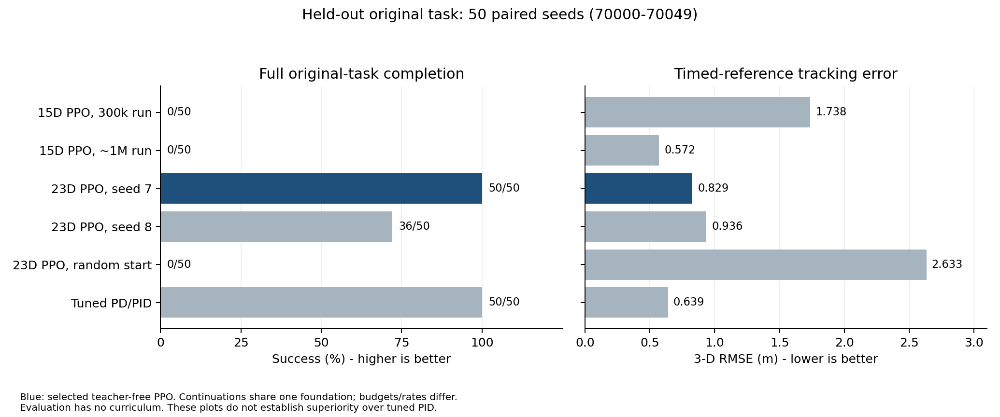
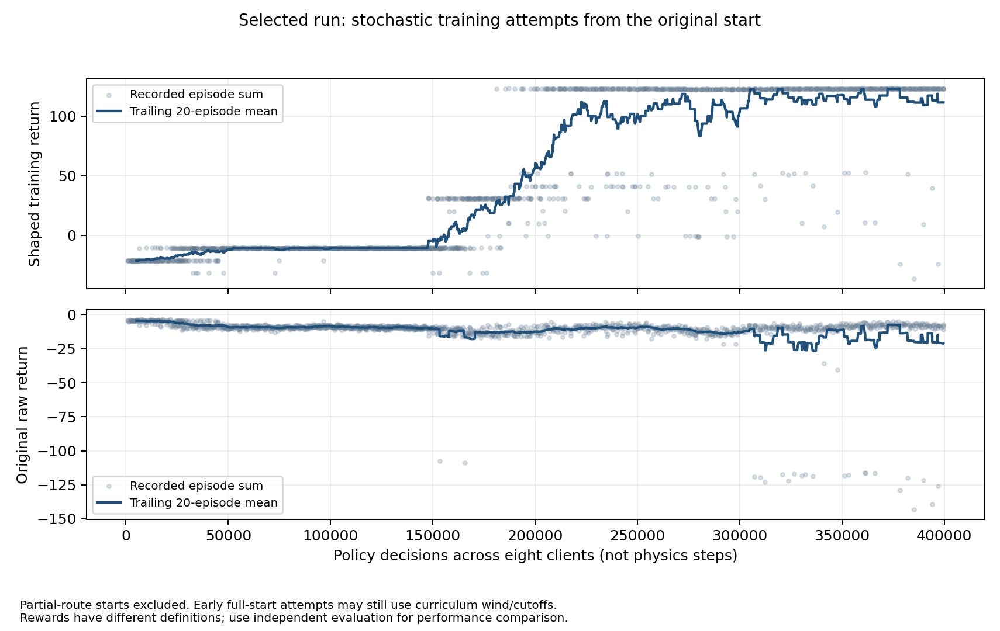

# Results guide - waypoint-aware PPO framework

These tables and plots use the recorded experiment data; this revision adds comments and clearer presentation, not new long training.

## What changed since the Neural Network submission?

The Oct-30 environment already counted ordered arrivals, but its policy did not observe that history. The third milestone exposes c/N (completed-waypoint fraction) and the error to waypoint[c] (next outstanding goal), plus velocity error and remaining time. It adds sustained PPO training and task-aligned feedback. This is not a new waypoint list or a relaxed success test.

The previous submission only demonstrated 128 transitions and one update. It did not report a trained policy success rate. The 15D policies below were trained later as baselines; do not label their scores as the second submission's demonstrated performance.

## 1. Held-out original task: completion and tracking are different metrics

50 paired seeds 70000-70049; original rest start, full wind/payload variation, 2 m/s reference, 45 s limit, all 10 ordered waypoints within 0.5 m in 3-D. Start counts once without reward. No training reset assistance, early cutoff or shaped test reward.

| Controller | Success | Mean ordered waypoints / 10 | Timed 3-D RMSE (m) | Original evaluation return |
|---|---:|---:|---:|---:|
| 15D PPO, 300k run | 0/50 (0%) | 1.00 | 1.738 | -79.185 |
| 15D PPO, ~1M run | 0/50 (0%) | 2.00 | 0.572 | -24.764 |
| 23D PPO, hold 4 | 43/50 (86%) | 9.20 | 0.835 | -10.757 |
| 23D PPO, seed 7 | 50/50 (100%) | 10.00 | 0.829 | -4.960 |
| 23D PPO, seed 8 | 36/50 (72%) | 9.40 | 0.936 | -16.017 |
| 23D PPO, random start | 0/50 (0%) | 2.00 | 2.633 | -107.414 |
| Original PD/PID | 6/50 (12%) | 4.48 | 0.823 | -26.245 |
| Tuned PD/PID | 50/50 (100%) | 10.00 | 0.639 | 2.498 |

**Interpretation:** the selected two-stage PPO completes all 50 sampled missions, but tuned PID also completes 50/50 and tracks the timed reference more accurately. The two continuation seeds share a foundation, the random-start variant fails, and no causal ablation isolates the new inputs. Unequal budgets/control rates and different episode lengths limit ranking claims. 50/50 Wilson 95% interval is 92.9%-100%.

## 2. Learning progress on fixed original-task validation

These are five-seed deterministic full-mission validation scores, not stochastic training reward and not the held-out 50-seed test.

| New policy decisions | Mean ordered waypoints / 10 | Success | Original validation return |
|---:|---:|---:|---:|
| 0 | 2.00 | 0% | -25.890 |
| 81920 | 3.00 | 0% | -33.260 |
| 163840 | 6.20 | 0% | -30.781 |
| 245760 | 10.00 | 100% | -4.704 |
| 327680 | 10.00 | 100% | -6.376 |
| 400000 | 10.00 | 100% | -5.676 |

## 3. Actual training reward

`training_return` sums the shaped training feedback; `raw_return` sums the inherited unscaled reward. Only original-start attempts are plotted, and early attempts can terminate under the training cutoff. Partial curriculum starts are excluded. Changing episode durations/distributions prevent a simple early-vs-late mean from being a matched performance estimate.

## 4. Strong-wind check after model selection

20 new paired seeds 80000-80019, max base wind 4.5 m/s rather than training 3 m/s, retaining the existing 0.7 m/s gust term. Not used to select the model.

| Controller | Success | Timed 3-D RMSE (m) | Original evaluation return |
|---|---:|---:|---:|
| Selected two-stage PPO | 17/20 | 0.844 | -17.474 |
| Original PD/PID | 1/20 | 0.822 | -26.382 |
| Tuned PD/PID | 20/20 | 0.633 | 2.868 |

## Remaining limits

Reference still advances by time even after a miss. The new observation exposes the uncompleted obligation; it does not remove reference-vs-arrival conflicts. No independent end-to-end multi-seed convergence, new-route generalization, real spray coverage, physical energy saving or real-flight safety claim is established.

Source data: `evidence/heldout_50/episodes.csv`, `summary.json`; `evidence/selected_run/validation.csv`, `episodes.csv`; `evidence/strong_wind_20/summary.json`. Full logs and negative trial histories are retained.
